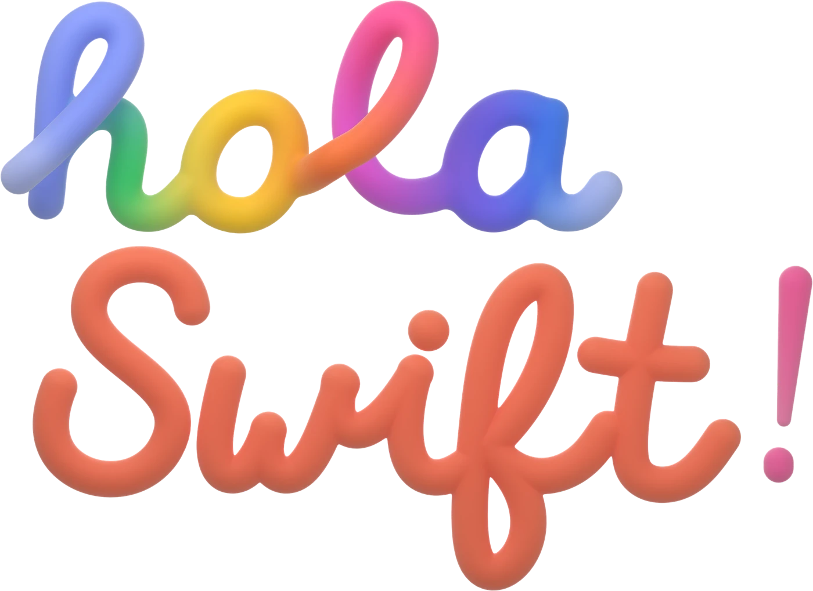

  

<b>La comunidad de Swift en español.</b>

Durante mucho tiempo, quien programa en Swift en español ha aprendido solo: documentación en inglés, vídeos en inglés y pocas
caras conocidas. hola Swift existe para cambiar eso. **Ya no estáis solos.**

- **Quedadas online cada mes.** El tercer miércoles de cada mes, a las 19:00 (hora de España), en Discord. Charlas cortas
  de la comunidad, en directo y en español.
- **Un encuentro en persona.** Lo estamos preparando.
- **Para todo el mundo.** De España y Latinoamérica, empecéis ahora o llevéis años con Swift.

**Apuntaos en [holaswift.com](https://holaswift.com)** y os avisamos de cada quedada.

## Aquí encontraréis

- **[presentaciones](https://github.com/holaswift/presentaciones)**: la skill de Claude para hacer diapositivas con la marca de hola Swift, la plantilla para ponentes y las fuentes. Si vais a dar una charla, empezad aquí.
- **[prensa](https://github.com/holaswift/prensa)**: el kit de prensa, con la nota de prensa, logos, glifos 3D, vídeos y fotos del equipo.

## Hablemos

- ¿Tenéis una charla en la cabeza? **comunidad@holaswift.com**
- ¿Sois una empresa y queréis apoyar a la comunidad? **patrocinio@holaswift.com**
- ¿Escribís sobre tecnología? **prensa@holaswift.com** · [holaswift.com/prensa](https://holaswift.com/prensa/)

[X](https://x.com/hola_swift) · [Bluesky](https://bsky.app/profile/holaswift.com) · [Mastodon](https://mastodon.social/@hola_swift) · [Instagram](https://www.instagram.com/hola_swift) · [Threads](https://www.threads.com/@hola_swift) · [LinkedIn](https://www.linkedin.com/company/hola-swift)

hola Swift es una comunidad independiente, sin relación oficial con Apple Inc. Swift y Apple son marcas de Apple Inc.
